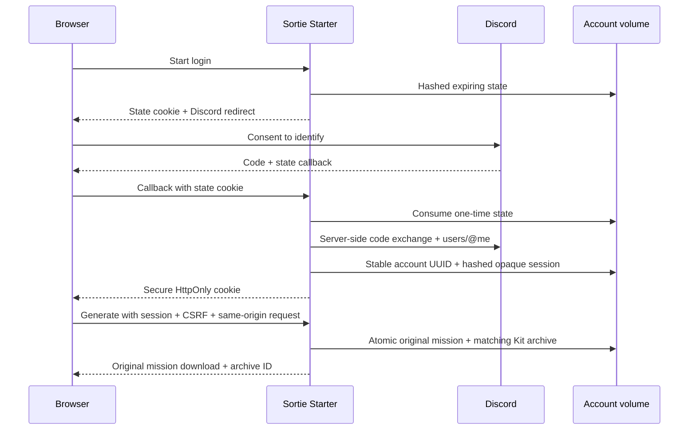

# Discord login and private missions

Status: sign-in and archives implemented in v1.115.0; explicit saved selections added in v1.116.0. A real user must still complete the production
Discord consent/callback and cross-device checks after deployment. Unit tests
mock the provider; they do not certify a live client secret or Portal setting.

## Existing application

- Client ID: `1547542914651922452` (public configuration).
- Production origin: `https://sortiestarter.com`.
- Registered callback: `https://sortiestarter.com/auth/discord/callback`.
- Scope: `identify`; authorization-code grant, server-side token exchange.
- Keep existing Dash One callbacks while that app uses this Discord application.
- The OAuth client secret is different from a bot token. Never commit either.

Portal: select the existing application → OAuth2 → Redirects → add the callback
exactly → Save Changes. No bot installation or message permissions are needed.
Use the existing client secret if available. Resetting it requires replacing
the value in every application using that OAuth client.

## Server configuration

`fly.toml` contains the public ID, `DISCORD_BASE_URL`, `ACCOUNTS_DATA_DIR` and
`ACCOUNTS_OWNER_MACHINE`. Production private requests replay to the same
volume owner as the pack catalog. Replica disks must never become account
fallback stores. When migrating the owner, stop writes and transfer the
database consistently before changing the machine ID.

Install `DISCORD_CLIENT_SECRET` through the hosting platform's secrets UI or
Fly secrets import. For an interactive **zsh** terminal, this keeps the value
out of shell history and terminal output:

```sh
read -rs 'sortie_discord_secret?Discord client secret: '
printf '\n'
printf 'DISCORD_CLIENT_SECRET=%s\n' "$sortie_discord_secret" | flyctl secrets import --stage --app dcs-mission-starter
unset sortie_discord_secret
```

The next app deployment applies staged secrets. Secret names/digests can be
checked with `flyctl secrets list`; do not print live environment values.
`GET /api/account` reports only whether configuration is present, the current
user (if any), that browser's CSRF token and profile limits. Configuration
presence is not a live credential check.

Missing configuration disables sign-in and leaves guest APIs working.
Self-hosted copies require their own explicit HTTPS origin, Discord redirect
and persistent directory. Secure cookies deliberately require HTTPS; use an
HTTPS development origin/tunnel and a separate registered callback for manual
local OAuth tests. Mock-provider automated tests do not contact Discord.

## Identity and trust boundaries



OAuth access/refresh tokens, codes and client secrets are not written to the
account database. Sessions are opaque random tokens, hashed in storage,
expiring after 30 days; at most 20 remain active per profile. Login state is
one-time and expires after 10 minutes. Cookies are host-only, Secure,
HttpOnly and SameSite=Lax, with the `__Host-` prefix and `/` path. The canonical site origin is explicit, never
inferred from an untrusted Host header. Mutations require both the exact
Origin and a session CSRF token. Private responses are no-store and
no-referrer. User input is escaped/text-rendered in the account UI.

The account UUID is independent of the Discord ID. This provides a migration
key for a future shared Authentic identity service, **not current SSO**.
Existing Dash One profiles are not imported or overwritten by this release.
No membership/subscription entitlement is inferred from Discord login.

## Storage and recovery

Accounts and original mission/Kit bytes are in
`ACCOUNTS_DATA_DIR/accounts.sqlite3` on the persistent owner volume. Archive
metadata includes resolved recipe, seed, app version, manifest and original
SHA-256. Storage writes and quota checks are transactional. Duplicate mission
hashes within a user's app version reuse their existing archive.

Selections are separate rows with canonical recipes or validated published pack/mission
references, selected content version and application version. They contain no
archived mission bytes. Pack references follow the current published catalog;
removing a publication can make a saved reference unavailable. Save requests
require the same ownership, Origin and CSRF checks as archive mutations. An
explicit browser save intent can survive OAuth in same-tab session storage for
ten minutes; URL parameters never instruct the app to save a recipe.

Limits: 100 saved selections plus 100 generated missions / 100 MB per user, 24 MB per combined archive, 512 MB
total stored mission bytes, and at least 256 MB free disk after admission.
Failed writes roll back; temporary generation directories are cleaned up.
Deleted data may leave reusable SQLite pages: logical quota usage can fall
without the database file immediately shrinking. Monitor both filesystem
free space and database size. A full-volume failure must never trigger
deleting content or routing writes to a different machine.

The volume is persistence, not a complete backup policy. Before owner/storage
migrations, take a consistent copy with SQLite's backup API, store it in
restricted operator storage, and verify restore to a separate location.
Do not copy a live database file using a plain filesystem copy. This release
does not configure off-site scheduled backups. Profile deletion cascades
through live sessions, selections and archives; independently retained operator backups
must follow the operator's retention/deletion policy.

## Production verification

1. `/api/account` enabled, guest user null; `/auth/discord` redirects to the
   expected client ID, exact callback and only `identify`.
2. Cancel consent: guest use still works; Builder selections remain.
3. Complete consent: a profile appears, with no token/code in the return URL.
4. Generate with saving enabled. Download `.miz` and original Kit; compare
   `.miz` bytes/hash with the Kit's mission and stored manifest.
5. Sign in on another device: the same profile and originals appear. Another
   Discord account cannot access any of those mission IDs.
6. Save a Library setup, collection and individual sortie before generation. Reopen them in My missions; verify settings versus published-reference labels, rename/remove, export and same-tab sign-in resumption. Rename an archive, edit in Builder, disable saving and sign out.
7. On a disposable test profile, delete it and verify every session/archive
   is inaccessible. Never use a real pilot's profile for a destructive test.
8. Verify current app version and account-owner routing on every Fly machine.

Sources: [Discord OAuth2](https://docs.discord.com/developers/topics/oauth2),
[discord.js application setup](https://discordjs.guide/rpc/app-setup).
